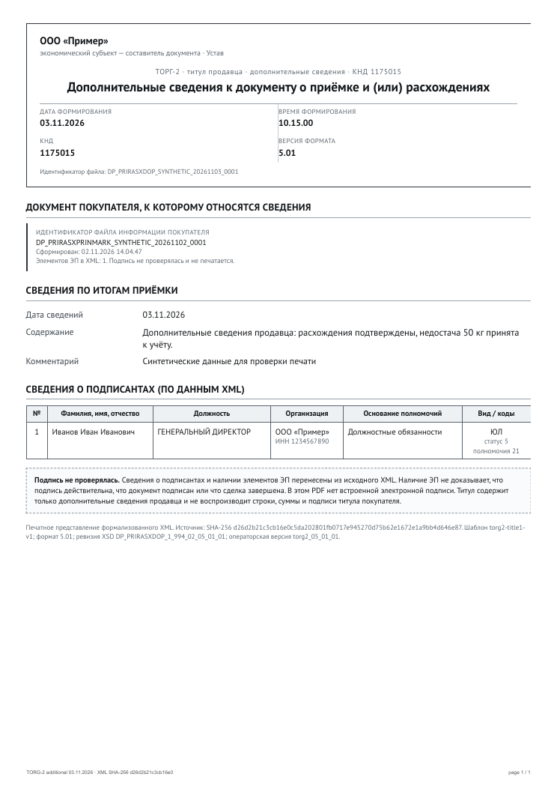
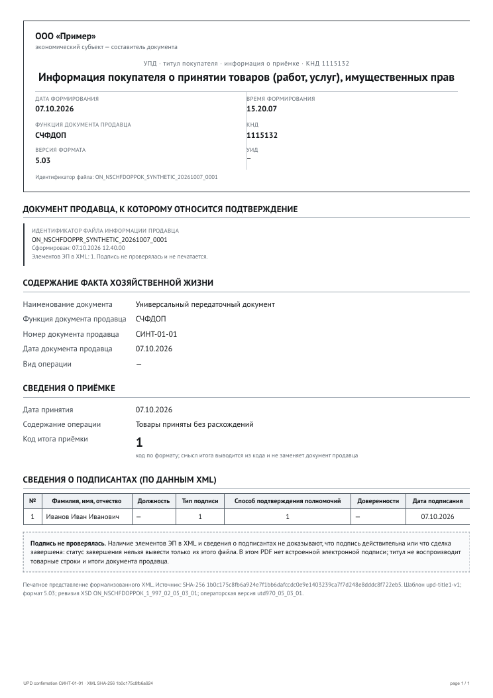

# Вторые титулы: проверка печати

Дата: 3 ноября 2026. Схемы:

- ТОРГ-2 титул 1: `DP_PRIRASXDOP_1_994_02_05_01_01.xsd` (`0bf55f20…2185`), шаблон `torg2-title1-v1`;
- УПД титул 1: `ON_NSCHFDOPPOK_1_997_02_05_03_01.xsd` (`41f04bd6…ccdf`), шаблон `upd-title1-v1`.

Оба титула печатаются на A4 **портрет**, один лист, и являются самостоятельным ответным
представлением: они ссылаются на файл первого титула и не воспроизводят отсутствующие у них товарные
строки, суммы и подписи.

## Происхождение образцов

| Fixture | Происхождение |
| --- | --- |
| `test/fixtures/torg2-title1.xml` | синтетический, собран по закреплённой XSD (реального образца ТОРГ-2 титул 1 нет) |
| `test/fixtures/upd-title1.xml` | обезличенный образец покупателя УПД: структура сохранена, данные заменены |

Оба проходят XSD только по своей схеме; чужие XSD их отклоняют (unit-тест `test/unit/xsd.test.ts`).

## Результаты

| Титул | Страниц | Байт | business | PDF SHA-256 |
| --- | --- | --- | --- | --- |
| ТОРГ-2, дополнительные сведения продавца | 1 | 96 470 | passed | `e498bd9ca6704539601744d8b5ffb96b47aae048821da8a67216f7b4acf34d58` |
| УПД, информация покупателя | 1 | 99 506 | passed | `90c4a412da05d8fe16d9383849c1dbd1b7cd65c4e810fd5170f2d1ee2cd17586` |

Для обоих: `unmapped=0`, приложение пусто, `signatureStatus: not-provided`.

### ТОРГ-2 титул 1

Печатается:

- организация-составитель, дата и время формирования, КНД 1175015;
- ссылка на файл покупателя `ИдФайлИнфПок` с датой, временем и **количеством** элементов `ЭП`
  (сама подпись не печатается и не проверяется);
- дата и содержание сведений по итогам приёмки, информационные поля;
- подписанты с основанием полномочий.

В ответе API: `titleIndex: 1`, `workflowFunction: "WithAdditionalInfo"`, `function: null`.
Дисклеймер прямо указывает, что титул не воспроизводит строки, суммы и подписи титула покупателя.

### УПД титул 1

Печатается:

- ссылка на файл продавца `ИдФайлИнфПр` с датой, временем и количеством `ЭП`;
- `СодФХЖ4`: наименование документа, функция, номер и дата документа продавца, вид операции;
- `СвПрин`: дата принятия, содержание операции, код итога приёмки, документ о расхождениях,
  лицо, принявшее товар;
- `ИнфПокЗаГоскКазн` (если заполнено) и информационные поля;
- подписанты и основание полномочий составителя.

Дисклеймер: статус завершения сделки нельзя вывести только из этого файла; наличие `ЭП` и сведения о
подписантах не доказывают действительность подписи.

## Изображения

## Ограничения

- Реальные обезличенные образцы ТОРГ-2 титул 1 не предоставлены; синтетика проверяет структуру и
  отсутствие потери полей, но не бизнес-содержание.
- Нормативная форма ответных титулов не утверждена; сверка с оператором не выполнялась.
- Наличие `ЭП` в XML — только факт наличия элемента, не проверка подписи.
