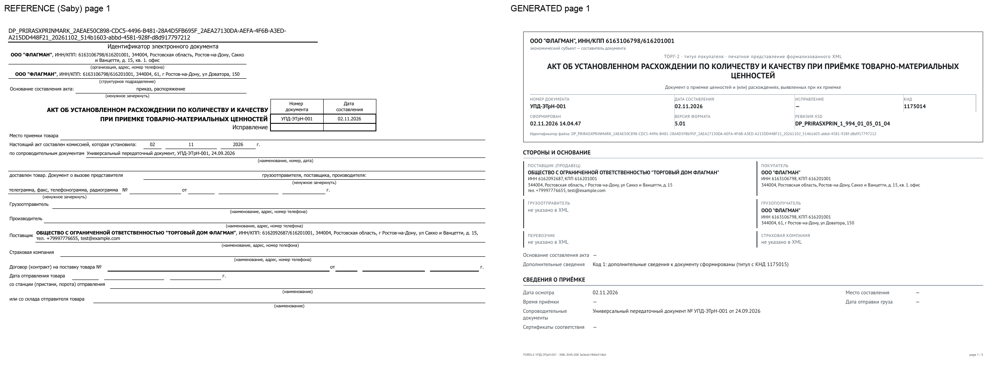
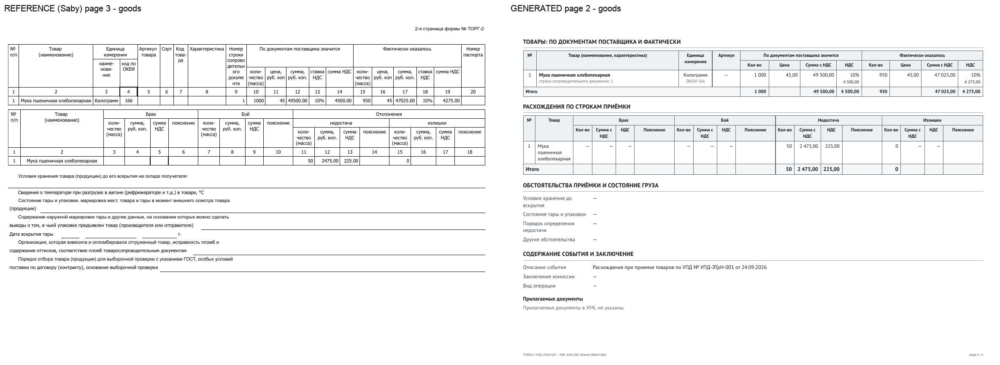

# Сверка: ТОРГ-2 из XML → PDF (локальный прогон)

Дата прогона: 3 ноября 2026. Входной файл: `test/fixtures/torg2.xml` (windows-1251, 2622 байта,
SHA-256 `3e3edc1fb6e31dbdb226b51ccd360ae86c75f427d320623f6e64db13d9b237e9`).

## Как получен результат

```bash
# сервис запущен локально: node dist/main.js
./scripts/convert-sample.sh
```

Сервис принял бинарное тело `application/octet-stream`, определил ТОРГ-2 (титул покупателя, КНД 1175014,
`ВерсФорм=5.01`), проверил по закреплённой XSD `DP_PRIRASXPRIN_1_994_01_05_01_04.xsd`
(SHA-256 `6139596b95a3f4635ea0eab34fab33ce4e0f4fbebe4282fac043760884d36084`), построил печатную модель,
сформировал PDF через Chromium и сохранил неизменяемый артефакт.

Ответ API (сокращён):

```json
{
  "status": "ready",
  "document": {"family": "Torg2", "formatVersion": "5.01", "titleIndex": 0, "knd": "1175014"},
  "validation": {"xsd": "valid", "business": "passed", "unmappedCount": 0},
  "pageCount": 3,
  "signingTarget": "pdf",
  "signatureProfile": "external-detached",
  "signatureStatus": "not-provided"
}
```

Сохранённый файл: [`torg2-sample-generated.pdf`](./torg2-sample-generated.pdf), 118 928 байт,
SHA-256 `54bf7d8f9c6783ba455d55475be8a6cef11274004ad8c276c0fcac3dec8c6092`.
Байты PDF при повторном скачивании и после перезапуска сервиса не меняются (проверяется тестом
`test/integration/conversion.test.ts`).

## Прогон в Docker-образе

Тот же образец прогнан в собранном контейнере (`xmltopdf:local`, non-root, Chromium sandbox включён,
`--read-only`, tmpfs `/tmp`, том `/app/data`):

| Параметр | Значение |
| --- | --- |
| `POST /api/v1/conversions` | `201`, XSD valid, `unmapped=0`, `business=passed` |
| PDF | 3 страницы, 102 600 байт, A4 landscape, PDF 1.4 |
| SHA-256 | `28422d6de909e8a67112b13381ccdc93f18a952a86a9d0f507b69a7d4aa58b18` |
| Шрифты | PT Sans Regular/Bold + DejaVu Sans для колонтитула, все встроены |
| Проверка текста | 22/22 смысловых проверок |
| Повторное скачивание после `docker restart` | те же байты, тот же SHA-256 |

Файл: [`torg2-sample-generated-container.pdf`](./torg2-sample-generated-container.pdf).
Размер и hash отличаются от локального прогона из-за подстановки шрифта колонтитула и служебных
идентификаторов Chromium; содержимое и композиция совпадают.

## Технические параметры

| Параметр | Эталон Saby (`torg2-reference.pdf`) | Сгенерированный PDF |
| --- | --- | --- |
| Страниц | 4 | 3 |
| Размер | 95 325 байт | 118 928 байт |
| Версия PDF | 1.7 | 1.4 (Skia/PDF m156) |
| Создатель | Saby / PDFService | Chromium / Skia |
| Формат страницы | A4, альбомная (841,92 × 594,96 pt) | A4, альбомная (841,92 × 594,96 pt) |
| Шрифты | Tahoma, Tahoma-Bold, ArialMT (встроены) | PT Sans Regular/Bold (встроены, Unicode), ArialMT для колонтитула |
| Шифрование | нет | нет |
| JavaScript / Launch / вложения | нет | нет |
| AcroForm | нет | нет |
| Извлечение текста | работает | работает (`pdftotext`), все значения читаются |

## Построчная сверка значений (раздел 2.3 спецификации)

| Показатель | XML | Эталон Saby | Сгенерировано |
| --- | --- | --- | --- |
| Номер акта | `УПД-ЭТрН-001` | есть | есть |
| Дата акта | `02.11.2026` | есть | есть |
| Дата осмотра | `02.11.2026` | есть (в шапке) | есть (отдельная графа) |
| Дата сопроводительного документа | `24.09.2026` | есть | есть, отдельно от даты акта |
| Наименование товара | `Мука пшеничная хлебопекарная` | есть | есть |
| Единица / ОКЕИ | `Килограмм` / `166` | есть | есть |
| Количество по документам | `1000` | `1000` | `1 000` |
| Цена по документам | `45` | `45` | `45,00` |
| Стоимость с НДС по документам | `49500.00` | `49500.00` | `49 500,00` |
| НДС по документам | `4500.00` | `4500.00` | `4 500,00` |
| Количество фактически | `950` | `950` | `950` |
| Стоимость с НДС фактически | `47025.00` | `47025.00` | `47 025,00` |
| НДС фактически | `4275.00` | `4275.00` | `4 275,00` |
| Недостача: количество | `50` | `50` | `50` |
| Недостача: стоимость с НДС | `2475.00` | `2475.00` | `2 475,00` |
| Недостача: НДС | `225.00` | `225.00` | `225,00` |
| Излишки: количество | `0` (явный ноль) | `0` | `0` (не пустая ячейка) |
| Сведения о подписанте | `СУХОМЛИНОВ СЕРГЕЙ ПЕТРОВИЧ` | **отсутствуют** | отдельный блок «по данным XML» |

Значения не пересчитываются: суммы и количества перенесены из XML, форматирование меняет только
разделители (`49500.00` → `49 500,00`) и не меняет величину. Арифметические проверки выполняются
отдельным набором правил `torg2-business-v1` и при расхождении дают предупреждение, а не исправление.

Автоматическая проверка: `node scripts/verify-sample.mjs test-output/generated.txt` — 22 из 22 проверок.

## Визуальное сравнение

Эталон (слева) и сгенерированный документ (справа):





## Композиционные отличия от эталона Saby

1. Эталон повторяет полный официальный бланк ТОРГ-2 с большим числом пустых граф (место приёмки,
   вызов представителя, транспортные разделы, комиссия), поэтому занимает 4 страницы. Сгенерированный
   документ — компактное печатное представление фактических данных XML: пустые графы не создаются,
   но обязательные реквизиты приёмки, товарные строки и расхождения присутствуют.
2. В эталоне нет сведений о подписанте, хотя они есть в XML. В сгенерированном PDF добавлен блок
   «Сведения о подписантах (по данным XML)» с явным дисклеймером: подпись не проверялась, встроенной
   подписи нет.
3. В сгенерированном документе на каждой странице есть колонтитул с коротким SHA-256 исходного XML и
   фактической нумерацией страниц; полный hash — в нижнем колонтитуле и метаданных артефакта.
4. Эталон не содержит приложения. В сгенерированном документе приложение предусмотрено, но для этого
   образца оно пусто: все содержательные поля XML выведены в основной бланк (`unmapped=0`).
5. Числовые форматы: эталон печатает `49500.00`, сгенерированный — `49 500,00` (русская локаль,
   значение и точность сохранены).

## Чего этот прогон не доказывает

- Не проверена внешняя подпись целевым средством: PDF подготовлен к отсоединённой подписи, но
  криптопровайдер и проверяющая сторона не участвовали. Технический round-trip с одноразовым
  самоподписанным ключом (`scripts/signing-roundtrip.sh`) проходит и выявляет изменение байта, но это
  не испытание ГОСТ-профиля. Утверждений «подписано» документ не содержит.
- Не проверен профиль PDF/A (не требуется базовым профилем).
- Печатная форма ТОРГ-2 не сверена с нормативным бланком построчно: композиция основана на образце
  заказчика и требованиях спецификации; см. `docs/compliance-matrix.md`.
- Для УПД и вторых титулов используются синтетические/обезличенные fixtures; нормативная сверка их
  печатных форм не выполнялась.
