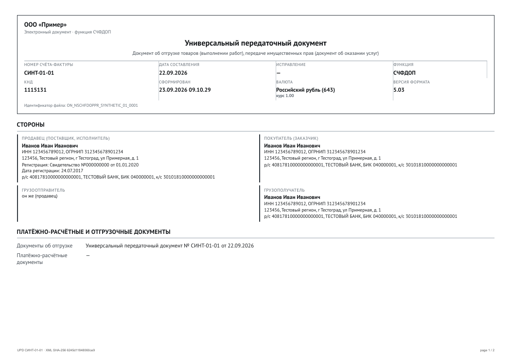
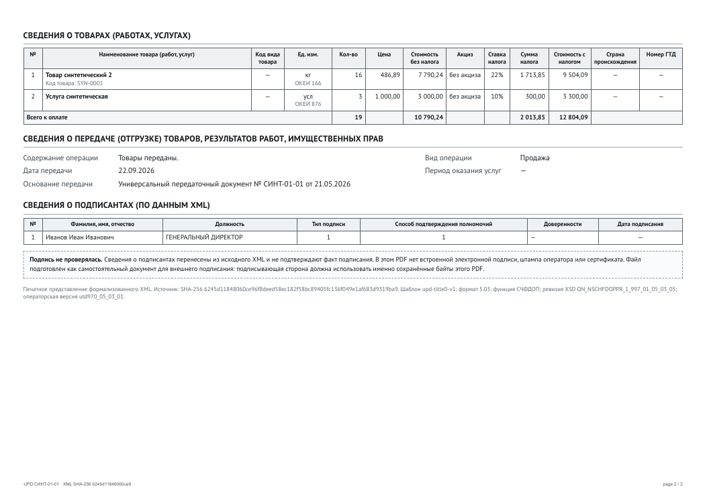
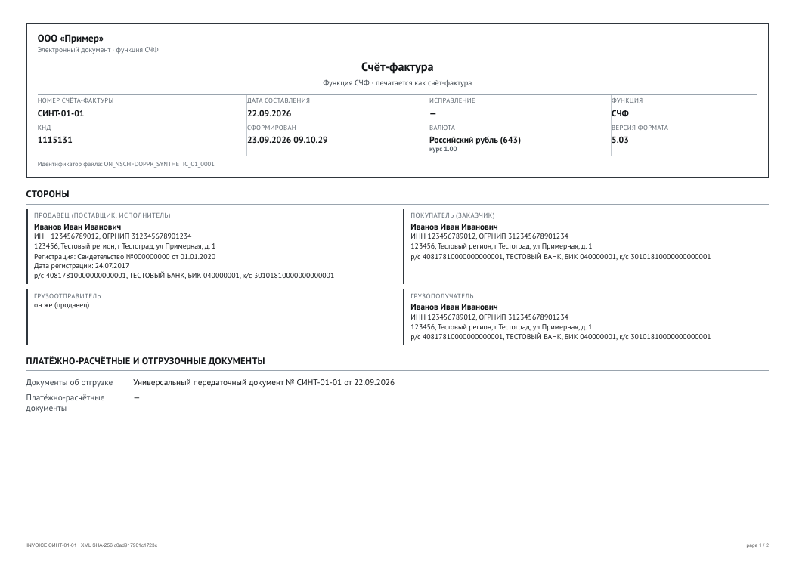
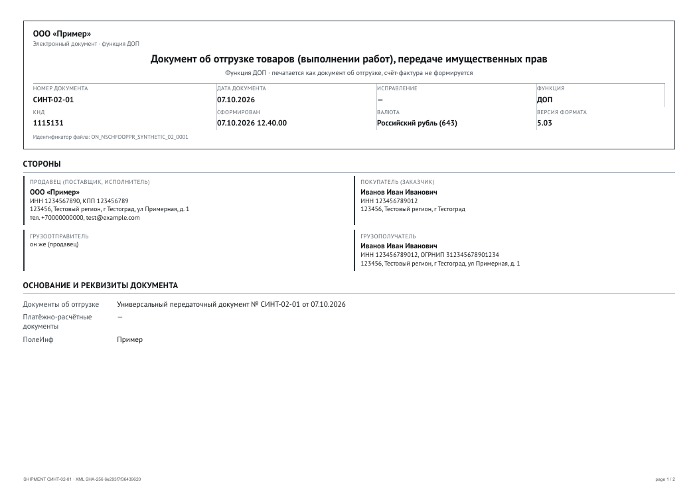

# УПД 5.03, титул продавца: проверка печатных вариантов

Дата: 3 ноября 2026. Схема: `ON_NSCHFDOPPR_1_997_01_05_03_05.xsd`
(SHA-256 `f98a1ac91cb840ff341976f7636d8a98d51a43e9b1cbbf3e97386551aacdb49a`).
Шаблон: `upd-title0-v1`. Бизнес-правила: `upd-business-v1`.

## Происхождение образцов

Реальные УПД заказчика не включены в репозиторий. Три fixtures получены обезличиванием
предоставленных образцов: структура и коды формата сохранены, все наименования, ИНН, адреса, номера,
банковские реквизиты, подписанты и идентификаторы заменены синтетическими значениями и проверены
повторной валидацией по XSD. Происхождение и SHA-256 — в `test/fixtures/provenance.json`.
Использовать их как доказательство реальных сценариев нельзя.

| Fixture | Функция | Содержимое |
| --- | --- | --- |
| `test/fixtures/upd-schfdop.xml` | СЧФДОП | две строки, ставки 22% и 10%, отгрузка, ИП, банк, подписант |
| `test/fixtures/upd-schf.xml` | СЧФ | те же строки, раздел отгрузки отсутствует |
| `test/fixtures/upd-dop.xml` | ДОП | одна строка, отгрузка без документа-основания |
| `test/fixtures/upd-svrk.xml` | СвРК | реализация комиссионером товаров комитента, информационное поле комитента |
| `test/fixtures/upd-svzk.xml` | СвЗК | закупка комиссионером товаров для комитента |

## Результаты

| Fixture | Страниц | Байт | business | PDF SHA-256 |
| --- | --- | --- | --- | --- |
| СЧФДОП | 2 | 107 986 | passed | `34b17485622d42c7c34ebc4f4813b2d6b89ef7778a8d4c2efcc051eb4fd428bc` |
| СЧФ | 2 | 107 227 | passed | `ce6d4b83d9569246e7922ea3d45527dac1d7e9740cbe90b7cafb1ac0c765cf5c` |
| ДОП | 2 | 106 595 | passed | `e07d8763b2f0d0fc3f8e9a9feee7e112343fd9808d14d58b82234ff284c6e588` |
| СвРК | 2 | 110 354 | passed | `120453ea040f548f6d63485032a9483513f50295ac746aa92aae0f532c5ebac5` |
| СвЗК | 2 | 109 957 | passed | `71020b42e58cdc43efba4c0e46a413a315c72d5136aa7684f4ec9108324338c6` |

Для всех трёх: XSD valid, `unmapped=0`, приложение пусто (все содержательные поля выведены в бланк),
подпись не проверялась, утверждений о подписании нет.

### Смысловая сверка

- Ставки НДС перенесены как в XML: `22%` и `10%`; суммы `7 790,24`, `1 713,85`, `9 504,09`,
  `3 000,00`, `300,00`, `3 300,00`; итоги `10 790,24 / 2 013,85 / 12 804,09`.
- Для СЧФ печатается счёт-фактура: заголовок «Счёт-фактура», нет раздела отгрузки.
- Для ДОП печатается «Документ об отгрузке…», есть раздел передачи, нет графы «Номер счёта-фактуры».
- Для СЧФДОП печатаются оба раздела; при наличии `СвПродПер` у функции СЧФ данные отгрузки не
  печатаются как часть счёта-фактуры, а уходят в приложение с предупреждением
  `TRANSFER_DATA_IN_INVOICE` (проверено unit-тестом).
- Для `СвРК`/`СвЗК` печатается отдельный вариант: функциональный заголовок, таблица товаров,
  сведения о комитенте (принципале) только из переданных информационных полей, дисклеймер
  «это не счёт-фактура и не УПД». Графы счёта-фактуры в заголовке не используются.

## Визуальная проверка

## Чего это не доказывает

- Не подтверждено соответствие печатной формы действующей редакции постановления № 970 и изменениям
  формы счёта-фактуры с 01.04.2026: нормативный профиль не утверждён, сверка построчно не выполнялась.
- Нет реальных обезличенных образцов СЧФ/ДОП/СЧФДОП от оператора; синтетика проверяет структуру и
  отсутствие потери полей, но не бизнес-содержание.
- Функции `СвРК` и `СвЗК` схемой допускаются, но их печатный вариант не реализован: ответ
  `422 UNSUPPORTED_FUNCTION`, как поддерживаемые они не заявлены.
- Титул покупателя УПД (КНД 1115132) реализован отдельно; см. `docs/reports/title1-fixtures.md`.
- Внешняя подпись не проверялась; см. `docs/signing-compatibility.md`.
