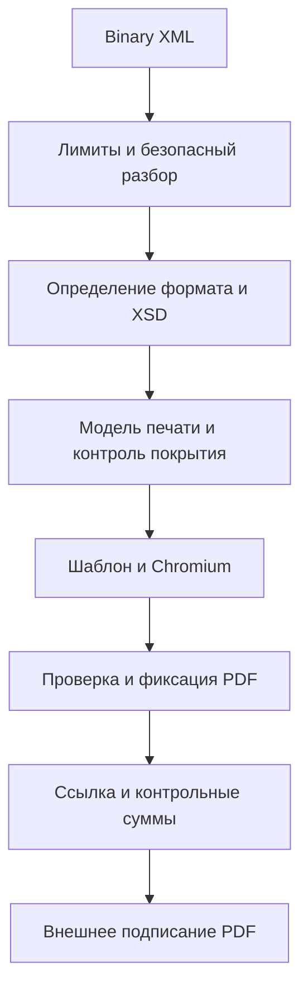

# Спецификация и план разработки конвертера XML в PDF

Дата исследования: 3 ноября 2026 года. Получатель: агент, который будет реализовывать сервис.

Сервис на NestJS принимает исходный XML как бинарное тело HTTP-запроса, определяет поддерживаемый формат, проверяет его по закреплённой полной XSD-схеме, формирует человекочитаемый PDF и возвращает ссылку на скачивание. Развёртывание — Docker; первый этап испытаний — локально. Стартовые семейства документов — ТОРГ-2 и УПД; архитектура должна позволять добавлять новые форматы отдельными адаптерами.

**Уточнённое требование заказчика: клиент подписывает именно PDF.** Результат конвертации должен быть самостоятельным законченным файлом, пригодным для передачи внешнему средству электронной подписи. В данном проекте реализуется конвертер и контракт передачи файла на подпись, а не криптографический сервис.

## 1. Что означает соответствие формату

Термин «формализованный PDF» для этого проекта заменить на «печатное представление формализованного XML, подготовленное к подписанию PDF». Не существует универсальной XSD-проверки PDF, которая докажет соблюдение всех требований к документам и подписям.

Разделять четыре независимые проверки:

1. XML соответствует конкретной полной XSD определённого титула и ревизии.
2. Печатная форма корректно передаёт данные XML и соблюдает применимые требования к реквизитам и виду документа.
3. PDF технически корректен и совместим с выбранным средством подписания.
4. Внешняя подпись проверяется и допустима для конкретного процесса обмена.

Проверка №1 не доказывает №2–4. Наличие картинки подписи или штампа не является проверкой электронной подписи. Без входной подписи и её проверки нельзя печатать утверждение «подписано», номер сертификата, время подписи или штамп оператора.

По документации Диадока PDF-печатная форма формализованного документа используется для просмотра и сама по себе не заменяет юридически значимый электронный оригинал [S1]. Подписанный клиентом PDF — отдельный электронный документ. В частности, его нельзя выдавать за замену XML-счёта-фактуры в формализованном ЭДО. Для ТОРГ-2 Контур допускает также неформализованный обмен [S6]; применимость конкретного PDF и вида подписи зависит от маршрута и получателя.

**Рабочий профиль первой версии:** PDF для внешней отсоединённой подписи над точными байтами готового PDF. Это архитектурный выбор для начала реализации, а не уже согласованное требование к криптопровайдеру. Если клиент использует встроенную подпись в PDF, потребуется отдельный профиль совместимости и испытание с его подписывающим ПО. Разработку конвертера можно вести до выбора провайдера; приёмку подписания завершать только на реальном целевом средстве.

## 2. Результаты исследования входных файлов

### 2.1 XML образец

В комплекте: `fixtures/torg2.xml`.

| Параметр | Проверенное значение |
| --- | --- |
| Размер | 2622 байта |
| Кодировка в XML declaration | windows-1251 |
| Корневой элемент | Файл |
| ВерсФорм | 5.01 |
| КНД | 1175014 |
| ИдФайл начинается с | DP_PRIRASXPRINMARK_ |
| Роль титула | Титул покупателя ТОРГ-2, titleIndex=0 |
| Документ | Акт о расхождениях № УПД-ЭТрН-001 от 02.11.2026 |
| Сопроводительный УПД | УПД-ЭТрН-001 от 24.09.2026 |
| Полная XSD | DP_PRIRASXPRIN_1_994_01_05_01_04.xsd |
| Результат валидации lxml/libxml2 | Успешно, ошибок XSD нет |
| SHA-256 XML | 3e3edc1fb6e31dbdb226b51ccd360ae86c75f427d320623f6e64db13d9b237e9 |

Имя XML-файла снаружи (`torg2.xml`) не соответствует значению ИдФайл, но это не мешает проверке содержимого по указанной XSD: сама схема ограничивает ИдФайл длиной, а не фиксированным префиксом. Не переименовывать и не исправлять XML молча. Если требуется проверка имени файла по правилам обмена оператора, реализовать её отдельным правилом; HTTP binary-вход вообще может не содержать исходного имени.

`DP_PRIRASXPRINMARK_` должен распознаваться как признак кандидата ТОРГ-2. Нельзя зашить детектор только под строку `DP_PRIRASXPRIN_`. Окончательное решение принимается по структуре, версии, КНД и XSD.

Образец не является УПД: слово «УПД» встречается в номере и ссылке на сопроводительный документ. Это обязательный тест против определения типа по произвольному тексту.

### 2.2 PDF образец

В комплекте: `fixtures/torg2.pdf`. Метаданные: Creator=Saby, Producer=PDFService, PDF 1.7, 4 страницы A4 в альбомной ориентации, без шифрования и AcroForm. SHA-256: `ae0eb642872369e2ec38ba4b7d19b7515012a72dd25dac91a00272b091ff79bb`.

PDF использует развёрнутую форму ТОРГ-2 с пустыми полями, двумя таблицами на странице с товаром и блоками комиссии. Это образец представления Saby, а не официальный шаблон Диадока и не доказательство нормативной корректности. Визуально проверена страница с товаром, текст извлечён со всех четырёх страниц.

В извлечённом тексте PDF не обнаружены ФИО и должность подписанта, хотя в XML они есть. Новая реализация должна выводить сведения о предполагаемом подписанте отдельным блоком без утверждения о состоявшемся подписании. Поле `ИнфДопСв=1` также должно быть учтено с правильной трактовкой по формату, а не потеряно при копировании внешнего вида образца.

Не копировать четыре страницы механически: при большем числе строк страниц будет больше. Допустимо сохранить композицию образца, добавить приложение для реквизитов, не помещающихся в основной бланк, и сквозную фактическую нумерацию страниц. Число страниц образца не является условием приёмки.

### 2.3 Проверенные данные товарной строки

| XML путь относительно Документ | Значение | Отображение |
| --- | --- | --- |
| ИдентДокПР/@НомДокПР | УПД-ЭТрН-001 | Номер акта |
| ИдентДокПР/@ДатаДокПР | 02.11.2026 | Дата акта |
| СодФХЖ1/СвОсмГруз/@ДатаОсм | 02.11.2026 | Дата осмотра |
| СодФХЖ1/СвОсмГруз/СопрДок/@ДатаСопрДок | 24.09.2026 | Отдельная дата сопроводительного документа |
| СодФХЖ2/РезПрием/Ценности/@НаимТов | Мука пшеничная хлебопекарная | Наименование товара |
| СодФХЖ2/РезПрием/@ОКЕИ_Тов | 166 | Код единицы |
| СодФХЖ2/РезПрием/@НаимЕдИзм | Килограмм | Единица |
| СодФХЖ2/РезПрием/ПоДокум/@КолТовПрин | 1000 | Количество по документам |
| СодФХЖ2/РезПрием/ПоДокум/@ЦенаПрин | 45 | Цена по документам |
| СодФХЖ2/РезПрием/ПоДокум/@СтоимТовНДСПрин | 49500.00 | Стоимость с НДС по документам |
| СодФХЖ2/РезПрием/ПоДокум/@СумНДСПрин | 4500.00 | НДС по документам |
| СодФХЖ2/РезПрием/ПоФакту/@КолТовПрин | 950 | Фактическое количество |
| СодФХЖ2/РезПрием/ПоФакту/@СтоимТовНДСПрин | 47025.00 | Фактическая стоимость с НДС |
| СодФХЖ2/РезПрием/ПоФакту/@СумНДСПрин | 4275.00 | Фактический НДС |
| СодФХЖ2/РезПрием/Недостача/@КолТовРасх | 50 | Недостача |
| СодФХЖ2/РезПрием/Недостача/@СтоимТовНДСРасх | 2475.00 | Стоимость недостачи с НДС |
| СодФХЖ2/РезПрием/Недостача/@СумНДСРасх | 225.00 | НДС недостачи |
| СодФХЖ2/РезПрием/Излишки/@КолТовРасх | 0 | Явный ноль, не пустая ячейка |
| Подписант/ЮЛ/ФИО | СУХОМЛИНОВ СЕРГЕЙ ПЕТРОВИЧ | Сведения о предполагаемом подписанте |

Цена по факту — 45, обе ставки НДС — 10%. Стоимость с НДС нельзя повторно умножать на ставку. Суммы и количества переносить из XML, не заменять пересчитанными значениями. Арифметические проверки нужны для диагностики, но исправлять первичный документ конвертер не вправе.

## 3. Схемы и границы поддержки

### 3.1 Матрица первой версии

| Семейство | ВерсФорм | Версия Диадока | Титул | КНД | Полная XSD |
| --- | --- | --- | --- | --- | --- |
| ТОРГ-2 | 5.01 | torg2_05_01_01 | 0, покупатель | 1175014 | DP_PRIRASXPRIN_1_994_01_05_01_04.xsd |
| ТОРГ-2 | 5.01 | torg2_05_01_01 | 1, дополнительные сведения продавца | 1175015 | DP_PRIRASXDOP_1_994_02_05_01_01.xsd |
| УПД | 5.03 | utd970_05_03_01 | 0, продавец | 1115131 | ON_NSCHFDOPPR_1_997_01_05_03_05.xsd |
| УПД | 5.03 | utd970_05_03_01 | 1, покупатель | 1115132 | ON_NSCHFDOPPOK_1_997_02_05_03_01.xsd |

Названия схем и КНД проверены по скачанным байтам. Все четыре XSD успешно компилируются XMLSchema; внешних include/import в этих экземплярах нет. В каталоге Диадока указаны версии и функции [S2], особенности титулов ТОРГ-2 приведены отдельно [S3]. Номера ревизий XSD и версии Диадока — разные сущности, сохранять обе.

Сначала реализовать вертикальный проход ТОРГ-2 titleIndex=0 и УПД titleIndex=0; затем вторые титулы. Первая завершённая версия должна поддерживать все четыре строки таблицы. До завершения конкретный титул не объявлять поддерживаемым в API.

Для УПД учитывать функции `СЧФДОП`, `ДОП`, `СЧФ`, а также допустимые схемой `СвРК` и `СвЗК`. Для каждой функции создать явно проверенный вариант печати. Нельзя автоматически печатать полноценную отгрузку для функции, выражающей другое содержание. Версии 5.01/5.02 УПД не входят в первую версию: возвращать контролируемую ошибку; архивная поддержка добавляется отдельно [S4].

Для ТОРГ-2 функции документооборота Диадока `NoAdditionalInfo` и `WithAdditionalInfo` не путать с произвольными значениями полей XML. Не выводить функцию обмена из одного имени файла. Если сведения об операторском документообороте не переданы и не выводятся однозначно, `workflowFunction=null` допустимо, пока это не влияет на выбор печатной формы.

Один запрос содержит один XML-титул. Второй титул, полученный отдельно, печатается как самостоятельное ответное представление с ссылкой на первый. Нельзя создавать отсутствующие строки, суммы или подписи первого титула. Объединение титулов в один PDF — отдельное расширение; при необходимости API должен принять оба оригинала и проверить их связь.

### 3.2 Правила работы с XSD

- Проверять полный финальный XML по `TitleXsd`, а не по `UserDataXsd`/UserContract. Упрощённая схема предназначена для входа генераторов XML Диадока [S2, S5].
- В комплект включены публичные XSD из документации. Сохранены SHA-256 и URL в `research/schema-report.json`.
- Для актуализации через авторизованный API использовать `GetDocumentTypes (V3)` и полученные `XsdUrl`/`GetContent`. Права ящика и доступ к API нужны только для этого способа получения схем, не для работы локального конвертера.
- Исходящий запрос к Диадоку при каждой конвертации запрещён. Сервис должен работать с закреплёнными локальными ресурсами без сети.
- При обновлении схемы сохранять новую ревизию и checksum, сравнивать ограничения и перечисления, запускать регрессию, выпускать версию приложения. Не перезаписывать старую ревизию в работающем контейнере.
- В скачанных XSD ТОРГ-2 и первого титула УПД уже присутствуют, в частности, ставки `22%` и `22/122`. Не использовать закрытый список ставок из старых примеров.
- XSD не выполняет все межполевые, арифметические и операторские проверки. Профиль бизнес-проверок хранить отдельно с идентификатором версии. Schematron выполнять только при наличии полученных правил и совместимого проверенного движка; не объявлять его выполненным лишь из-за xmlns:sch в XSD.

### 3.3 Определение формата

Последовательность: безопасно прочитать метаданные → отобрать кандидатов из реестра по корню/namespace, версии, КНД, структуре и префиксу ИдФайл → проверить соответствующие XSD → выбрать единственный подходящий адаптер.

Префикс — подсказка, а не единственное доказательство. `xsi:schemaLocation`, PI и адреса из входного XML не использовать для загрузки ресурсов. Название загрузки, номер документа и `ВерсПрог` не определяют формат.

При неоднозначности печатного представления одного XML разрешить query `documentType=Torg2|UniversalTransferDocument|Invoice`; значение проверять на совместимость, не использовать для обхода XSD. Если без подсказки возможны разные печатные смыслы, вернуть `409 AMBIGUOUS_DOCUMENT_TYPE` со списком кандидатов. Различие операторского типа и XML-формата особенно существенно для счёта-фактуры [S4]. `Invoice` здесь — уточнение печати для функции СЧФ, а не обещание отдельного нового формата.

## 4. Архитектура

Рекомендуемое начальное решение: NestJS + Express, TypeScript strict, Swagger/OpenAPI, локальные XSD, безопасный XML-парсер, libxml2/xmllint для XSD, типизированные модели печати, серверные HTML/CSS-шаблоны и Playwright Chromium для PDF. Метаданные — SQLite, файлы — локальный Docker volume. Redis, брокер и S3 для первого этапа не требуются.

Версии Node.js, NestJS и зависимостей выбрать из совместимых поддерживаемых релизов в начале реализации, зафиксировать lockfile и Docker image digest. Номер «последней версии» в эту спецификацию не зашит.

Поток обработки:



Модули:

| Модуль | Обязанность |
| --- | --- |
| ConversionModule | HTTP orchestration, DTO, Swagger, единая обработка ошибок |
| XmlSecurityModule | Проверка кодировки, запрет DTD/entities, лимиты дерева |
| DocumentRegistryModule | Реестр семейств, версий, функций, титулов, схем и шаблонов |
| ValidationModule | XSD и отдельные бизнес-проверки |
| MappingModule | Типизированная модель и покрытие исходных полей |
| RenderingModule | HTML-шаблоны, локальные шрифты, Chromium pool |
| ArtifactModule | Файлы, SQLite, TTL, скачивание и неизменяемость |
| AccessModule | API key/principal, capability-ссылки, квоты |
| HealthModule | liveness/readiness, метрики и версия ресурсов |

Не сводить все документы к модели «шапка + товарная таблица»: оставить отдельные `Torg2PrintModel` и `UpdPrintModel`, а общими сделать стороны, адреса, деньги, единицы и provenance.

Пример контракта адаптера — ориентир, а не готовая реализация:

```ts
interface DocumentAdapter<TPrintModel> {
  descriptor: AdapterDescriptor;
  matches(metadata: XmlMetadata): boolean;
  validateBusiness(xml: ParsedXml): ValidationReport;
  map(xml: ParsedXml): {
    model: TPrintModel;
    coverage: MappingCoverage;
  };
  render(model: TPrintModel): Promise<Buffer>;
}
```

Добавление нового типа: схема + manifest + адаптер определения + модель + карта полей + шаблон + XML fixtures + смысловые и визуальные тесты. Контроллер и хранилище при этом не переписывать.

## 5. Безопасный бинарный вход и XML

### 5.1 HTTP body

Основной вход: `Content-Type: application/octet-stream`, тело — исходные байты файла. Дополнительно разрешить `application/xml` и `text/xml`, обрабатывая их тем же byte-preserving путём. JSON/base64 и multipart не нужны для основного контракта.

В NestJS/Express подключить raw body parser для маршрута и перечисленных Content-Type до middleware, способных преобразовать тело. Не полагаться на то, что флаг `rawBody` сам по себе зарегистрирует обработку octet-stream. На входе контроллера должен быть проверенный Buffer [S9]. Не вызывать `buffer.toString('utf8')` для произвольного XML: данный образец в CP1251.

Поддержать UTF-8 с/без BOM, Windows-1251, UTF-16LE/BE с корректной идентификацией по BOM/сигнатуре/declaration. Использовать XML-совместимые правила определения кодировки, строгую проверку ошибок декодирования и непротиворечивости. Charset HTTP не должен молча менять XML declaration. Неизвестные или конфликтующие кодировки — ошибка 400.

Исходные байты сохранить отдельно без нормализации пробелов, перевода строк, BOM и повторной сериализации. SHA-256 вычислять именно от них. Внутренняя Unicode-копия нужна только для анализа и печати.

### 5.2 XML безопасность

- До libxml2 выполнить безопасный разбор с запретом DTD, объявления сущностей и внешних ссылок. Проверять после корректного декодирования, включая UTF-16; простой поиск ASCII `<!DOCTYPE` в Buffer недостаточен.
- Для предварительного разбора подходит строгий namespace-aware SAX-парсер без внешнего resolver; выбрать библиотеку после проверки её действующих настроек и тестов. DOM/JSON-преобразование не должно терять порядок, повторяющиеся узлы и текст.
- Отключить XInclude, загрузку DTD, внешние сущности, сетевые и произвольные файловые resolver. Встроенные XML entities и корректные числовые ссылки допустимы.
- `xmllint --nonet --noout --schema <trusted-local-xsd> <private-input>` применять только после предварительной проверки; `--nonet` не запрещает чтение `file://` и не является полной защитой.
- Не использовать `--noent`, `--loaddtd`, `--xinclude`, `--recover`, `--huge`. Запускать `spawn/execFile` с массивом аргументов без shell, ограниченным временем и объёмом stderr; private tempfile без пользовательского пути [S11].
- Схемы и их зависимости доступны только из доверенного read-only каталога. Пользователь не может загрузить XSD/XSLT/HTML-шаблон или указать путь к ним.
- Не выполнять XML stylesheets, произвольные выражения и инструкции обработки. Данные экранировать при выводе в HTML. Не применять пользовательские URL как href/src.
- Начальные лимиты: 10 MiB исходного тела; 30 MiB после декодирования; 100 тысяч элементов; глубина 64; 100 тысяч символов в одном значении; 1000 товарных строк; не более 100 страниц. Это настройки продукта, не ограничения XSD. Превышение — явная ошибка, без обрезки результата.

### 5.3 Значения

ИНН, КПП, ОКЕИ, артикулы, номера документов, коды маркировки хранить строками. Не терять ведущие нули. Деньги и количества разбирать decimal-библиотекой; `Number` для расчётов не использовать. Сохранять исходное строковое представление для аудита. В печати допустима русская локаль, если точность и значение не меняются.

Отсутствующее поле, пустая строка и ноль — разные состояния. Даты без времени не переводить через UTC Date. Времена документа не заменять временем генерации PDF. Контрольные даты из разных блоков не объединять.

## 6. Печатные формы и полнота

### 6.1 Требования к отображению

Для каждого семейства подготовить карту полей `XML XPath → printModel → место в PDF → правило форматирования`. Учитывать все допустимые ветви XSD, а не только поля образца: российские/иностранные адреса, ЮЛ/ИП/ФЛ, несколько сторон и подписантов, доверенности, исправления, вложенные строки, маркировку, прослеживаемость, произвольные дополнительные сведения.

Для каждого реально заполненного атрибута/текста входного документа фиксировать один статус:

- `rendered`: выведен в основной форме;
- `appendix`: выведен в приложении, являющемся частью того же PDF;
- `technical`: служебное поле по проверенному allowlist с объяснением;
- `unmapped`: данных в результате нет; для финального PDF запрещено.

Неиспользованное содержательное поле — `422 UNMAPPED_DATA`, а не тихое предупреждение. Служебные поля вроде версии программы можно исключать из основного бланка по allowlist, но связь с источником сохраняется в метаданных. Покрытие проверяется по вхождениям с индексами, а не только по названиям XML-элементов. Ветви с маркировкой и длинными описаниями могут уходить в читаемое приложение, без усечения.

Приложение не заменяет обязательную строку или графу основной формы. Если для реквизита установлено место в обязательной форме, он должен быть в этом месте. Нельзя создавать видимость подписания пустыми факсимиле, печатями, автоматически подставленными ФИО комиссии или отметками об утверждении.

### 6.2 ТОРГ-2

Базовая композиция — представленный образец: стороны, основание и сопроводительные документы, информация о приёмке, таблица «по документам / фактически», таблица недостачи/излишков/брака/боя, обстоятельства и заключение. Сведения подписантов — отдельный блок, если их роль нельзя достоверно сопоставить председателю или члену комиссии.

Результаты приёмки могут повторяться. Сведения о товаре и его отклонениях связывать по одной исходной строке. Не объединять товары по наименованию. Явно различать цены, стоимость с НДС и НДС. Пустые печатные поля допустимы при отсутствии соответствующих сведений в XML; не заполнять их предположениями из текста бланка.

Для titleIndex=1 разработать отдельную форму дополнительных сведений, а не повторять титул покупателя с пустой таблицей. Сохранять ссылки на исходный документ и данные ответной стороны.

### 6.3 УПД

Шаблоны должны учитывать функцию, титул, дату документа и ревизию нормативного профиля. Нельзя использовать один старый шаблон УПД из интернета для всех случаев. Для СЧФ/СЧФДОП проверить счёт-фактурную часть по действующей редакции постановления №1137; для ДОП не создавать отсутствующий счёт-фактуру. Поля исправления не путать с корректировкой УКД.

В 2026 году изменилась форма счёта-фактуры, в том числе реквизиты авансовых счетов-фактур; ФНС указывает применение новой формы с 01.04.2026 [S7]. Зафиксировать профиль для документов с этой даты и отдельно обработать даты до неё. Реализация обязана сверить строки и графы по актуальной редакции акта на дату разработки. Конвертер переносит ставку из XML, включая 22%, и не меняет исторические 20% на 22% по дате.

Отображать идентификацию документа и исправлений, стороны и адреса, платёжные/отгрузочные/авансовые основания, валюту, полные строки, единицы, количества, цены, суммы без НДС, ставки и суммы НДС, итог с НДС, страны происхождения, таможенные и прослеживаемые реквизиты, сведения о передаче/приёмке, подписантов и дополнительные данные, если они присутствуют. Конкретные XPath и условные обязательности агент извлекает из закреплённой XSD, сверяет с нормативным профилем и фиксирует в карте.

Для ответного титула печатать его действительное содержание; статус завершения сделки или наличие подписей нельзя вывести только из отдельного XML.

### 6.4 Технический профиль PDF

- Базовый формат — обычный PDF, генерируемый закреплённой Chromium-версией, ориентир совместимости PDF 1.7. Проверять фактическую версию и принятие целевым подписывающим ПО.
- A4, преимущественно альбомная ориентация для широких таблиц. Настройки размера, полей и ориентации — часть versioned template.
- Встроенные локальные шрифты с кириллицей, допустимой лицензией и Unicode mapping. Текст выделяется, копируется и извлекается. Скриншоты страниц вместо текстового PDF не допускаются.
- Повтор шапок таблиц, перенос длинных слов/идентификаторов, перенос больших строк с явным продолжением, отсутствие обрезки, наложений, случайных пустых страниц. Для строки выше страницы нужен отдельный механизм продолжения; одного CSS break-inside:avoid недостаточно.
- Минимально целевой размер основного текста — 9 pt. Не уменьшать всё содержимое до нечитаемого размера ради ограничения страниц.
- Дожидаться `document.fonts.ready`, применять print CSS, `printBackground`, `preferCSSPageSize`; проверять вывод внутри Docker [S10]. Шаблоны, CSS, шрифты и словари поставлять локально.
- Запрет JavaScript/Launch actions в итоговом PDF, шифрования, внешних ресурсов, скрытых вложений. Подписное поле AcroForm не требуется для отсоединённой подписи.
- PDF/A не объявляется обязательным по умолчанию. Если принимающая сторона требует PDF/A-2b или другой профиль, добавить отдельную ветку генерации/конвертации и проверять veraPDF до фиксации итоговых байтов. Chromium сам по себе не гарантирует PDF/A.
- PDF/A-конвертация, добавление реквизитов, пагинации, служебного footer и любых подписных полей завершаются до внешнего подписания.

## 7. Контракт подготовки PDF к подписи

### 7.1 Что гарантирует конвертер

После успешной генерации вернуть `artifactId`, `pdfSha256`, точный XML hash и версии ресурсов. PDF не сохраняется: байты живут в in-memory кэше и отдаются по короткоживущей ссылке; `artifactId` — идентификатор записи кэша, а не файла на диске. SHA-256 здесь — контроль целостности и сопоставления, не выбор ГОСТ-алгоритма электронной подписи.

На каждой странице вне обязательных полей допустима короткая строка «Источник XML: <идентификатор/короткий hash>». Полный source hash — в метаданных PDF и manifest. Hash самого PDF находится только вне PDF: попытка вставить его в тот же файл создаёт самоссылку и меняет hash.

`GET /downloads/{token}` не рендерит документ повторно: он отдаёт байты из памяти, пока живы токен и запись кэша. Изменение исходника, шаблона или ресурса даёт новый `artifactId` и новый PDF. Клиент обязан сохранить файл сразу после скачивания. После рестарта, истечения TTL или вытеснения из кэша ссылка даёт 404, и документ запрашивается заново.

Побайтовая воспроизводимость обеспечена нормализацией: фиксированные `CreationDate`/`ModDate` и producer `xmltopdf`, поэтому повторный рендер тех же байтов даёт тот же `pdfSha256`.

### 7.2 Внешняя отсоединённая подпись

Клиент получает PDF, сверяет его контрольную сумму, показывает его пользователю и передаёт те же байты криптопровайдеру. Результат — исходный PDF и отдельная CMS/CAdES-подпись в профиле, который согласован с принимающей системой. Расширение `.sig` само по себе не задаёт контейнер, алгоритмы или уровень подписи. КЭП/НЭП/ПЭП и требования к сертификату определяются процессом, не конвертером [S8].

Внешняя система хранит PDF и подпись совместно, проверяет подпись, цепочку сертификатов, полномочия и требования к времени/отзыву в своём контуре. Не просить закрытые ключи, PIN или контейнеры сертификатов в XML→PDF API.

### 7.3 Встроенная подпись PDF

Если выбран PAdES или иной встроенный профиль, подписывающее средство может добавлять Signature Dictionary, ByteRange, поля и инкрементальные ревизии. Hash финального подписанного PDF будет отличаться от hash исходного PDF. Связь фиксировать как `unsignedPdfSha256` и `signedPdfSha256`, а проверку выполнять средствами соответствующего подписного профиля. Нельзя проверять встроенную подпись простым равенством двух полных SHA-256.

Совместимость ГОСТ-подписей, PDF-полей и viewer не выводится из фразы «PDF 1.7». Нужен тест с выбранным поставщиком и инструментом проверки. До этого не объявлять универсальную совместимость с любым сервисом подписи.

### 7.4 Приёмка подписи

На целевом средстве выполнить: просмотр → подпись PDF → успешная независимая проверка → изменение одного байта в подписанных данных → ошибка проверки. Проверить второй подписант/инкрементальное подписание, если это требуется процессом. Криптооперации выполняются вне конвертера; интеграционный протокол и результаты испытаний входят в итоговую поставку проекта.

## 8. HTTP API и Swagger

API version prefix: `/api/v1`. Основная конвертация синхронная, ограниченная по времени. Не смешивать ответы 201 и 202 в первой версии.

### 8.1 Создание PDF

`POST /api/v1/conversions?documentType=Torg2` — query необязателен, кроме неоднозначных случаев.

Заголовки: `Content-Type: application/octet-stream`, `X-API-Key: <key>`. Тело — бинарный XML. В Swagger: `requestBody` с `type: string, format: binary`; ответ — `application/pdf` (binary), метаданные в `X-*` заголовках.

Успех 201, `Location: /api/v1/conversions/<artifactId>`:

```json
{
  "artifactId": "f84a18d9-7c7f-448e-a03d-1872f82cd29c",
  "status": "ready",
  "document": {
    "family": "Torg2",
    "formatVersion": "5.01",
    "operatorVersion": "torg2_05_01_01",
    "titleIndex": 0,
    "function": null,
    "workflowFunction": null,
    "knd": "1175014"
  },
  "validation": {
    "xsd": "valid",
    "schemaRevision": "DP_PRIRASXPRIN_1_994_01_05_01_04",
    "schemaSha256": "6139596b95a3f4635ea0eab34fab33ce4e0f4fbebe4282fac043760884d36084",
    "businessRulesVersion": "torg2-business-v1",
    "business": "passed",
    "unmappedCount": 0
  },
  "sourceSha256": "3e3edc1fb6e31dbdb226b51ccd360ae86c75f427d320623f6e64db13d9b237e9",
  "pdfSha256": "<64 hex characters computed from actual PDF>",
  "pdfSizeBytes": 105000,
  "pageCount": 4,
  "templateVersion": "torg2-title0-v1",
  "signingTarget": "pdf",
  "signatureProfile": "external-detached",
  "signatureStatus": "not-provided",
  "downloadUrl": "http://localhost:3000/api/v1/downloads/<opaque-token>",
  "createdAt": "2026-11-03T10:00:00.000Z",
  "expiresAt": "2026-11-04T10:00:00.000Z",
  "warnings": []
}
```

Пример схематический: размер/страницы/время — иллюстрация, не обещание о будущем результате. `business=passed` означает только выполненный собственный versioned набор правил, не проверку всех норм законодательства или правил оператора. Допустимы `passed-with-warnings` и `not-configured`; последнее запрещено в релизе для объявленного подписного профиля. Предупреждения не скрывают ошибок потери данных.

`function` — функция XML, если применима. Операторские варианты обмена сохранять отдельно. Достоверно определённую функцию заполнять, а не оставлять null как в иллюстрации.

### 8.2 Остальные методы

> **Реализовано иначе (ADR-0003).** На проде нет постоянного тома, поэтому PDF не сохраняется:
> `POST /api/v1/conversions` возвращает JSON с `downloadUrl`; `GET /downloads/{token}` отдаёт PDF
> из in-memory кэша. `GET /conversions/{id}` не реализован. Повтор в пределах TTL отдаётся
> из in-memory кэша, после рестарта документ рендерится заново. Клиент сохраняет байты сам.
> `Idempotency-Key` отсутствует; `artifactId` — идентификатор записи in-memory кэша.


| Метод | Назначение | Защита |
| --- | --- | --- |
| GET /api/v1/downloads/:token | Точный PDF из in-memory кэша | Ограниченный bearer capability-token |
| GET /health/live | Процесс работает | Минимальные данные |
| GET /health/ready | Кэш, схемы, шрифты и renderer готовы | Минимальные данные |
| GET /docs | Swagger UI | Локально; в production выключить или защитить |
| GET /openapi.json | Машиночитаемый контракт | Как /docs |

Скачивание: `Content-Type: application/pdf`, `Content-Disposition: attachment; filename="document.pdf"; filename*=UTF-8''...`, `Content-Length`, `Cache-Control: private, no-store`, `X-Content-Type-Options: nosniff`, сильный `ETag` на основе hash. Имя для скачивания безопасно сформировать из типа/номера/даты; в файловом хранилище использовать только внутренний ID.

TTL ссылки — `DOWNLOAD_TOKEN_TTL_SECONDS` (15 минут), но не дольше записи в кэше (`CACHE_TTL_SECONDS`). Токен криптографически случайный, 256 бит, хранится только в памяти процесса. Ссылка даёт право скачать файл любому, кто ею владеет: не писать её в access logs или Referer. Отзыва токена по API нет: он исчезает вместе с процессом или записью кэша.

Истёкший, неизвестный, вытесненный и потерянный при рестарте download-token возвращает одинаковый 404. Метаданных по `artifactId` нет: `GET /api/v1/conversions/{id}` не реализован. Не отдавать XML по общедоступному статическому маршруту.

### 8.3 Ошибки

Единый JSON: `statusCode`, `code`, `message`, `requestId`, `details`. Для ошибок XSD — номер строки/позиция и безопасное описание, без абсолютных путей и полного XML. Количество detail ограничить, например 50; отдельно передавать `truncated=true`.

| HTTP | Код | Условие |
| --- | --- | --- |
| 400 | EMPTY_BODY / MALFORMED_XML / INVALID_ENCODING | Пустой, синтаксически неверный XML, ошибка кодировки |
| 400 | UNSAFE_XML | DTD, entity declarations, запрещённые ссылки/инструкции |
| 401 / 403 | UNAUTHORIZED / FORBIDDEN | Неверная аутентификация / действие запрещено политикой |
| 409 | AMBIGUOUS_DOCUMENT_TYPE | Неоднозначная печать |
| 413 | XML_LIMIT_EXCEEDED | Превышены байты, глубина, число элементов или строк |
| 415 | UNSUPPORTED_MEDIA_TYPE | JSON, архив, произвольный файл вместо XML |
| 422 | UNSUPPORTED_DOCUMENT / UNSUPPORTED_VERSION / UNSUPPORTED_TITLE / UNSUPPORTED_FUNCTION | Корректный XML вне матрицы |
| 422 | XSD_VALIDATION_FAILED / BUSINESS_VALIDATION_FAILED | Несоответствие закреплённым проверкам |
| 422 | UNMAPPED_DATA / PDF_PAGE_LIMIT_EXCEEDED / UNRENDERABLE_CONTENT | Неполное или неприемлемое представление |
| 429 | TOO_MANY_REQUESTS | Квота владельца |
| 503 | RENDERER_BUSY / STORAGE_UNAVAILABLE / RENDERER_UNAVAILABLE | Перегрузка, диск, процесс печати |
| 504 | CONVERSION_TIMEOUT | Превышен общий deadline |
| 500 | CONVERSION_FAILED | Непредвиденная внутренняя ошибка |

По перегрузке отдавать Retry-After. Ошибка не создаёт доступный «готовый» PDF. Файлы не сохраняются, поэтому повтор после сбоя — обычный новый запрос.

### 8.4 Идемпотентность

Отдельного ключа нет. Повтор определяется содержимым: fingerprint включает raw XML hash, параметры печати и зафиксированный schema/template/render profile. Одинаковые байты в пределах `CACHE_TTL_SECONDS` получают тот же PDF из памяти процесса (`X-Cache: HIT`) и то же имя файла; другой XML — новый PDF. Кэш локален для процесса и исчезает при рестарте.

При обновлении активных ресурсов меняется fingerprint, поэтому новый запрос даёт новый PDF. Между владельцами кэш не разделяется.

## 9. Хранение и эксплуатация

Один API process и ограниченный пул Chromium. Файлового хранилища и БД нет: PDF и XML существуют только в памяти на время запроса и в LRU-кэше (`CACHE_TTL_SECONDS`, `CACHE_MAX_BYTES`). Шаблоны, XSD и шрифты поставляются read-only в image; `xmllint` пишет временный файл в `os.tmpdir()` и удаляет его. Docker volume для данных не нужен.

Кэш не разделяется между репликами; после рестарта документ рендерится заново, байты детерминированы. Аудита выданных файлов нет: клиент сохраняет PDF сам.

Лимиты по умолчанию: 2 параллельные печати, не более 10 ожидающих запросов, 30 секунд общий deadline, отдельный timeout XSD и render, 50 MiB на итоговый PDF. При переполнении очереди 503. При зависании renderer убить context/process и освободить permit в finally. Не запускать бесконечное число browser instances. Стартовая Docker-конфигурация для измерений: 2 CPU, 2 GiB RAM, shm_size 256 MiB; уточнить после нагрузочного прогона. Это бюджет испытаний, не измеренный SLA.

Удаление по TTL каждые 5 минут и при старте; просроченные артефакты перестают скачиваться сразу по expiresAt, даже до физического удаления. Удалять XML, PDF, tokens и относящиеся персональные метаданные; для 410 допустим короткоживущий минимальный tombstone без содержимого. Передача на подпись не означает долговременное хранение: подписывающая система обязана забрать файл до TTL и хранить его со своей подписью.

Для production: TLS на reverse proxy, явный PUBLIC_BASE_URL из доверенной конфигурации, а не Host/X-Forwarded-Host клиента; аутентификация, владельцы и квоты; секреты вне image; резервирование при необходимости хранения; стратегия перехода на PostgreSQL + object storage для нескольких реплик. Не выдавать production-ссылку localhost.

Локальный Compose публикует `127.0.0.1:3000:3000`. Запросы защищены тестовым API key из .env; небезопасный режим без ключа не делать настройкой по умолчанию.

## 10. Docker и renderer безопасность

Использовать совместимый закреплённый Playwright/Chromium image на Debian/Ubuntu или собственный Debian image с точно совпадающей версией browser package. Multi-stage build, `npm ci`, non-root UID, init/reaping, writable volume и tmpfs, healthcheck и SIGTERM graceful shutdown.

Не отключать Chromium sandbox автоматически для обхода ошибок запуска. В spike проверить запуск non-root с подходящим seccomp/user namespaces. Если текущая среда требует специальных параметров, описать конкретные настройки и границы изоляции; выпуск с неограниченным renderer неприемлем для недоверенного XML.

Renderer использует только доверенный шаблон и экранированные данные. Отключить исполнение JavaScript, service workers, навигацию на внешние адреса, обращения к сети и файловой системе через URL. Шрифты/ресурсы внедрять из доверенных байтов. Не включать file:// доступ к произвольным путям. Проверить egress deny на уровне context и контейнера; одного request interception может быть недостаточно для всех каналов.

Приложение не пишет XML, товары, ФИО, API keys, токены скачивания или полные URL в логи. Структурированные логи: requestId, artifactId, adapter, версии, размеры, длительности, код ошибки. Метрики: latency по стадиям, queue depth, RSS, browser restarts, XSD failures, bytes stored. Диагностика не должна превращаться в утечку документов.

## 11. Тестирование и критерии приёмки

### 11.1 Проверки исходных данных и схем

Положительный тест: неизменённый CP1251-образец проходит XSD ТОРГ-2 title0 и печатается без искажения кириллицы. Отрицательные проверки этого же файла по трём чужим XSD должны проваливаться. В `schema-report.json` результаты `sample_valid=false` для них ожидаемы, это не неисправность схем.

Для УПД и вторых титулов реальных образцов не приложено. Агент должен получить разрешённые обезличенные fixtures у поставщика/оператора либо сформировать синтетические по XSD, маркировать происхождение и отдельно подтвердить реальные сценарии. Генерация валидного XML проверяет структуру, но не доказывает нормативную пригодность бизнес-содержания.

Обязательная матрица: каждый титул, каждая объявленная функция, все допустимые ставки НДС, ЮЛ/ИП/ФЛ и адресные варианты, отсутствующие optional-поля, повторяющиеся элементы, исправления, дополнительные сведения и длинные коды. Для значений enum генерировать отдельные fixtures или параметризованные тесты, не перечислять в коде только известные старые ставки.

### 11.2 Смысловая и визуальная проверка PDF

- Извлечь текст из сформированного PDF и сравнить проверенные значения из раздела 2.3; отдельно суммы, НДС и даты. Проверять каждую строку и связь с товаром, а не только наличие значения где-либо в документе.
- Покрытие входных содержательных полей — 100% как `rendered`/`appendix`; technical только по allowlist; `unmapped=0`.
- Суммы не меняются при форматировании, нули остаются нулями, ведущие нули кодов сохраняются.
- Рендерить PDF в PNG через Poppler, визуально проверить все страницы набора эталонов. Сравнивать с утверждёнными собственными golden images на закреплённом Linux renderer; ограниченные допуски на антиалиасинг, без маскирования товарных таблиц и реквизитов.
- Образец Saby используется для проверки композиции и значений, а не побайтового сравнения. Любые изменения композиции и список расхождений приложить к отчёту.
- Кейсы 1, 10, 100 и 1000 строк; максимально длинная строка/наименование; многострочная ячейка выше страницы; пустые optional-блоки; приложение маркировки; несколько подписантов.
- Извлечение текста не доказывает отсутствие обрезки. Проверять геометрию/скриншоты, читаемость, корректность переносов, полноту шапок, footer и нумерацию.
- Структурная проверка PDF (`qpdf --check` или эквивалент), embedded fonts/Unicode, отсутствие шифрования и активных действий. Если включён PDF/A — отдельный отчёт veraPDF.

### 11.3 API, безопасность и lifecycle

| Группа | Обязательный сценарий |
| --- | --- |
| Body | Настоящий octet-stream в Swagger и curl, UTF-8/CP1251/UTF-16, BOM, конфликт declaration |
| Неверный ввод | Пустой файл, JSON/base64, PDF/ZIP вместо XML, malformed XML |
| Определение | УПД в номере ТОРГ-2 не меняет тип; MARK-префикс работает; неизвестная версия/титул/функция явно отклоняются |
| XSD | Неверный КНД, отсутствующий required-атрибут, недопустимый enum, лишний элемент |
| XXE | file://, HTTP external entity, parameter entities, UTF-16 DOCTYPE, XInclude, entity expansion |
| HTML | XML с <script>-подобным текстом, CSS/HTML-инъекцией и внешними URL не выполняется и не грузит ресурсы |
| Лимиты | Oversize body/tree/rows/pages, долгий XSD, очередь, timeout renderer |
| Скачивание | 10 скачиваний имеют одинаковый SHA-256; after restart те же байты; истечение TTL и токена |
| Изоляция | Чужой principal не получает metadata; угадывание artifactId не даёт скачать файл |
| Идемпотентность | Параллельные повторы, изменённый XML/параметр, новая версия шаблона, оборванный HTTP-ответ |
| Восстановление | Падение browser, API после rename, SQLite busy, закончившийся диск, orphan cleanup |
| Подпись | Реальный PDF подписан выбранным средством, проверка успешна, изменение подписанных данных выявляется |

Тестовую подпись с самоподписанным сертификатом можно использовать для технического tamper-test, но она не заменяет испытание нужного КЭП-профиля и реальных полномочий.

### 11.4 Нагрузочная проверка

На зафиксированной машине прогнать типовые 1–10-страничные документы и тяжёлые fixtures, серии 1/2/5/10 одновременных запросов; снять p50/p95, max RSS, размер temp/data, число рестартов и процент ошибок. Исходный ориентир для типового документа — p95 до 10 секунд при concurrency=2 на 2 CPU/2 GiB. Это целевая гипотеза для измерения, а не уже подтверждённая производительность. Для тяжёлых входов допустимо корректное ограничение, но не усечение содержимого.

### 11.5 Итоговая приёмка

1. Чистый checkout запускается одной документированной командой Docker Compose.
2. Swagger позволяет отправить binary XML и скачать готовый PDF по ссылке.
3. Все четыре титула и заявленные функции имеют свои положительные/отрицательные fixtures и печатные эталоны.
4. Приложенный ТОРГ-2 проходит XSD и смысловую сверку всех значений; исходные байты не изменены.
5. Есть проверенные карты XML→PDF, нормативные профили и отсутствие потери содержательных полей.
6. Нет заявлений о подписи/сертификате при отсутствии подписи. PDF неизменяем и проходит реальный целевой signing round-trip.
7. УПД учитывает действующую форму счёта-фактуры для соответствующей даты, включая изменения 2026 года.
8. Security/lifecycle/перезапуск/TTL/нагрузочные тесты пройдены, ограничения задокументированы.
9. Сервис работает без доступа к Диадоку и внешним шрифтам после сборки image.
10. Передан отчёт о совместимости с конкретным средством подписи. Без него конвертация может считаться реализованной, но требование подписи целевого клиента ещё не принято.

## 12. Пошаговый план для агента

Выполнять этапы последовательно. По завершении каждого оставлять работающий проверяемый результат. Не начинать с универсального генератора бланков из XSD: схема описывает данные, а не полиграфическую композицию.

| Этап | Работа | Результат и условие перехода |
| --- | --- | --- |
| 0. Инвентаризация | Прочитать эту спецификацию, проверить hashes схем и fixtures; сверить нормативные формы; записать выбор библиотеки XML, поддерживаемые кодировки и подписной профиль | ADR решений, manifest ресурсов, перечень недостающих реальных XML и провайдера подписи |
| 1. Технический spike | Docker + NestJS raw route + Swagger; CP1251 Buffer; безопасный SAX preflight + XSD subprocess; Chromium non-root; один минимальный PDF с кириллицей | Внутри контейнера доказаны binary input, XSD, шрифты, sandbox и запрет egress |
| 2. Реестр форматов | Четыре schema descriptors, метаданные, кандидаты и XSD dispatch, ошибки неоднозначности/неподдержки | Пример определяется как ТОРГ-2 title0; чужие XSD отклоняют его; API не обещает недоделанное |
| 3. ТОРГ-2 title0 | Типизированный mapper, полная карта полей и coverage, шаблон на основе образца, подписи/допсведения, пагинация | Пример, многострочные и пограничные fixtures проходят смысловую и визуальную сверку |
| 4. УПД title0 | Модели и fixtures функций, налоговые/прослеживаемые/маркировочные ветви; действующая счёт-фактурная часть | Для всех заявленных функций/дат есть утверждённые эталоны и непотерянные поля |
| 5. Ответные титулы | Отдельные формы ТОРГ-2 title1 и УПД title1, ссылки на исходник | Нет выдуманных данных первого титула; четыре строки матрицы реализованы |
| 6. Ответ и кэш | Без файлов и БД: PDF в ответе, in-memory LRU, hashes, idempotency | Повтор в пределах TTL отдаёт те же байты; после рестарта sha совпадает |
| 7. Подготовка к подписи | Freeze всей обработки до hashing; manifest; внешний round-trip выбранным провайдером | Подпись проверяется и изменение выявляется; зафиксирован конкретный проверенный профиль |
| 8. Эксплуатация | Health, timeouts, лимиты pool/queue, cleanup, graceful shutdown, безопасные логи | Падения/перегрузка/диск не создают утечки или частичные готовые PDF |
| 9. Регрессия и поставка | Unit/integration/e2e/visual/security/load, OpenAPI, README, отчёт соответствия | Выполнены критерии раздела 11.5, явно перечислены ограничения |

Если провайдер подписи ещё не выбран, этапы 0–6 и 8–9 можно выполнять, а внешний round-trip оставить единственным конкретно указанным непроверенным интеграционным критерием. Не заменять его догадками о «любом CryptoPro».

### 12.1 Рекомендуемая структура репозитория

```text
src/
  conversions/
  xml-security/
  document-registry/
  validation/
  documents/torg2/
  documents/upd/
  rendering/
  artifacts/
  access/
  health/
resources/
  schemas/<family>/<operator-version>/<revision>/
  manifests/
  templates/
  fonts/
  dictionaries/
docs/
  specification.md
  field-maps/
  normative-profiles/
  adr/
  signing-compatibility.md
  compliance-matrix.md
test/
  fixtures/
  integration/
  e2e/
  security/
  golden/
scripts/
Dockerfile
compose.yaml
.env.example
README.md
package-lock.json
```

### 12.2 Что должно войти в поставку

Исходники, зафиксированные зависимости, Dockerfile/Compose, .env.example без секретов, OpenAPI, migrations, реальные и синтетические обезличенные fixtures с provenance, схемы/checksums, карты полей, нормативные профили, golden PDF/PNG, команды тестов, отчёт сравнения с примером, измерения производительности и signing-compatibility report.

`compliance-matrix.md` содержит строки: тип/титул/функция/ревизия XSD/дата нормативного профиля/шаблон/проверки/подписной профиль/фактический статус. Не писать «поддерживаются все форматы» вне этой матрицы.

### 12.3 Команды будущего локального испытания

Это контракт для будущего проекта; в текущем исследовании конвертер не реализован.

```bash
cp .env.example .env
docker compose up --build -d
curl -fsS http://localhost:3000/health/ready
curl --fail-with-body \
  -H 'X-API-Key: local-test-key' \
  -H 'Content-Type: application/octet-stream' \
  -H 'Accept: application/json' \
  --data-binary @test/fixtures/torg2.xml \
  http://localhost:3000/api/v1/conversions > conversion.json
```

API key в примере тестовый; фактическое значение берётся из .env. Ссылку взять из JSON и скачать PDF без изменения байтов. Зафиксировать hash, проверить текст/страницы, затем передать файл внешнему подписывающему средству. Отдельно повторить через Swagger UI: curl-тест не доказывает правильность Swagger binary upload.

## 13. Решения, которые остаются на интеграцию

| Вопрос | Принято для разработки | Что нужно для окончательной проверки |
| --- | --- | --- |
| Объект подписи | Именно PDF, подтверждено заказчиком | Нет |
| Вид подписи и поставщик | Конвертер готовит PDF; базовый контракт — внешний detached | Название ПО/API, профиль CMS/CAdES/PAdES, требования к КЭП/ГОСТ, проверяющая сторона |
| Обмен через оператора | Не входит в конвертер; PDF не выдаётся за XML-оригинал | Маршрут отправки, если заказчик планирует такой обмен |
| Внешний вид | Композиция ТОРГ-2 по примеру + полнота данных; УПД по нормативному профилю | Утверждение печатных эталонов и сравнение на реальных XML |
| PDF/A | Не обязателен в базовом профиле | Только явное требование получателя/архива |
| Хранение | 24 часа, скачивание по токену 15 минут | Изменение сроков, если клиентский процесс дольше |
| Производительность | Один контейнер, ограниченный синхронный API | Измеренная нагрузка; при превышении — отдельная async-версия контракта |

Эти вопросы не препятствуют проектированию и локальной реализации, но ограничивают заявления о готовности конкретного подписного и юридического процесса.

## 14. Источники и воспроизводимость

Источники проверены 03.11.2026. Скачанные схемы находятся в комплекте; их точные URL и hashes — в `research/schema-report.json`. Отчёт подтверждает компиляцию четырёх XSD и проверку приложенного XML; он не является сертификатом соответствия PDF.

- [S1. Диадок — работа с печатными формами](https://developer.kontur.ru/doc/diadoc-api/instructions/documents/printforms.html). Назначение печатных форм, разграничение просмотра и электронного оригинала. Также описан GeneratePrintFormFromAttachment как возможный внешний сравнительный инструмент. Не использовать его как обязательную runtime-зависимость; для ТОРГ-2 каталог не обещает стандартную ПФ, а fallback с XML-текстом непригоден для задачи.
- [S2. Диадок — форматы и полные XSD](https://developer.kontur.ru/doc/diadoc-api/docflows/formats.html). Каталог схем, версии, титулы и отличие UserDataXsd.
- [S3. Диадок — работа с ТОРГ-2](https://developer.kontur.ru/doc/diadoc-api/instructions/documents/formal/torg2.html). Роли титулов и функции обмена.
- [S4. Диадок — документооборот УПД](https://developer.kontur.ru/doc/diadoc-api/docflows/utd.html). Версия 5.03 и различие типа документа/функции для визуализации.
- [S5. Диадок — GetDocumentTypes V3](https://developer.kontur.ru/doc/diadoc-api/http/GetDocumentTypes_V3.html). Авторизованное получение доступных версий и XsdUrl.
- [S6. Контур — форма ТОРГ-2](https://www.diadoc.ru/docs/forms/44614-torg_2). Приказ №423 и возможность неформализованного представления акта.
- [S7. ФНС — форма счёта-фактуры в 2026 году](https://www.nalog.gov.ru/rn91/ifns/ifns_simph/info/16602300/). Изменение формы с 01.04.2026, ссылка на нормативную редакцию. Перед выпуском сверить действующий нормативный акт; информационная публикация помечена ФНС архивной.
- [S8. Контур — подписание документов электронной подписью](https://www.diadoc.ru/docs/faq/faq-169). Подписи файлов и различие присоединённой/отсоединённой формы.
- [S9. NestJS — Raw Body](https://docs.nestjs.com/faq/raw-body) и [OpenAPI request body](https://docs.nestjs.com/openapi/types-and-parameters). Настройка сохранения тела и binary-схемы API.
- [S10. Playwright — page.pdf](https://playwright.dev/docs/api/class-page#page-pdf). Print CSS и параметры генерации.
- [S11. libxml2 — xmllint](https://gnome.pages.gitlab.gnome.org/libxml2/xmllint.html). XSD-валидация и параметры парсера.
- [S12. ФНС — визуализация XML](https://edo2.nalog.gov.ru/visual). Возможный ручной контрольный инструмент для поддерживаемого перечня, не зависимость локального сервиса. Не загружать туда пользовательские документы без разрешения.

Локальные входные материалы: `fixtures/torg2.xml` и `fixtures/torg2.pdf`, предоставленные заказчиком. Сервис, шаблоны, подпись и эксплуатационные тесты в рамках настоящего задания не реализованы: результат задания — спецификация, проверенные схемы и план для следующего агента.
